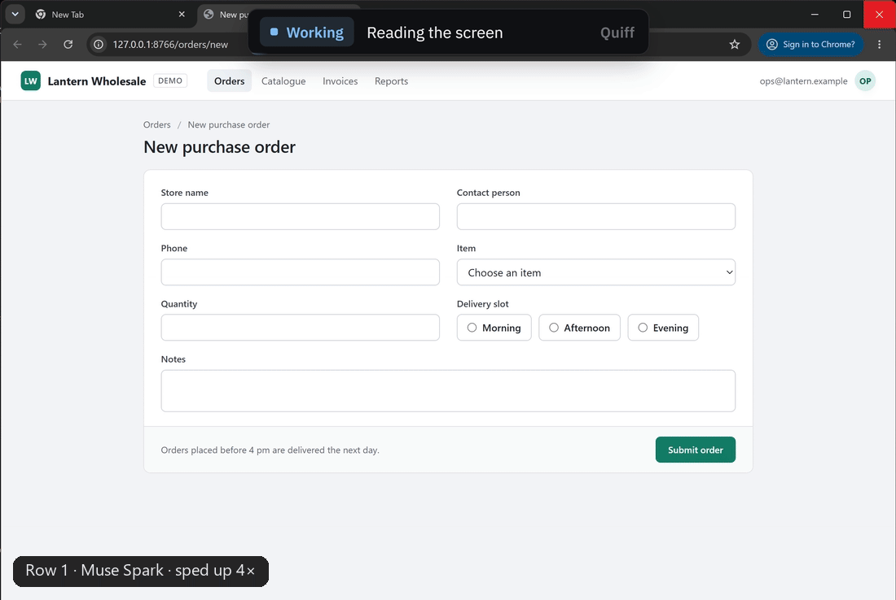
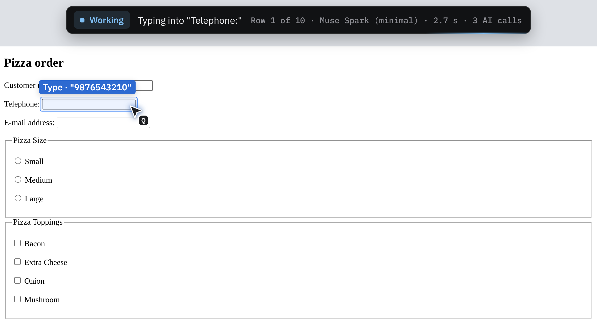
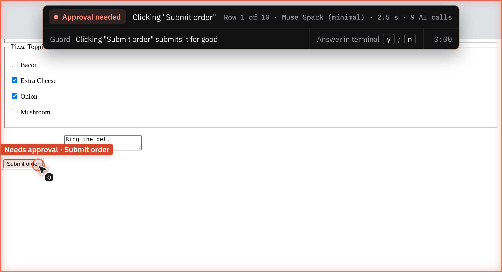
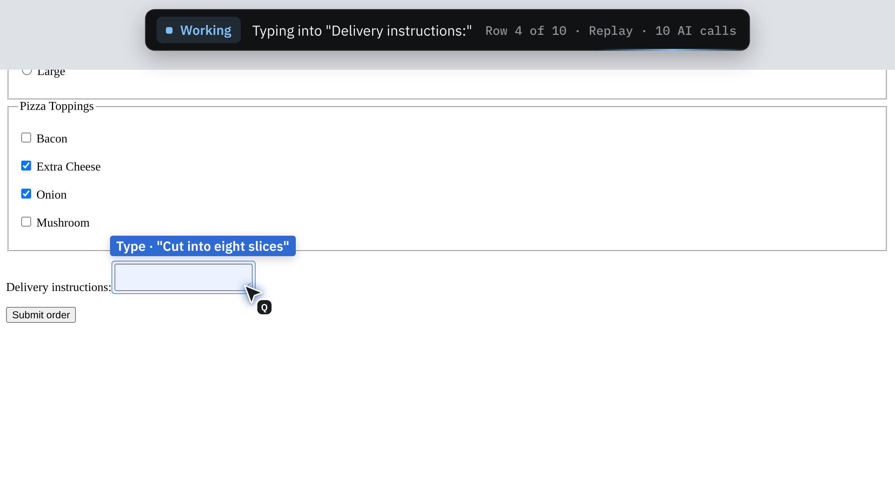
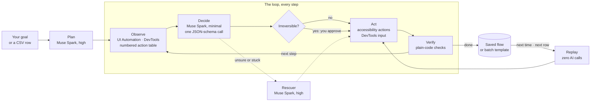

<p align="center">
  <picture>
    <source media="(prefers-color-scheme: dark)" srcset="docs/brand/logo-dark.svg">
    
  </picture>
</p>

<h3 align="center">Give your computer a chore once.</h3>

<p align="center">
  Quiff does chores in real Windows apps and Chrome. Meta's Muse Spark works out the steps the first time,<br>
  code checks every result, and from then on Quiff repeats the chore in seconds with zero AI calls.
</p>

<p align="center">
  <a href="https://github.com/CodeNeuron58/quiff/actions/workflows/ci.yml"></a>
  
  
  
  <a href="#built-during-the-hackathon"></a>
</p>

<p align="center">
  <a href="#quick-start">Quick start</a> ·
  <a href="#features">Features</a> ·
  <a href="#how-it-works">How it works</a> ·
  <a href="#the-numbers">The numbers</a> ·
  <a href="docs/RESULTS.md">Evidence</a>
</p>

<p align="center">
  <br>
  <sub>Ten orders from a spreadsheet: Muse Spark learns row 1, the guard asks before <i>Submit</i>, rows 2–10 replay with zero AI calls</sub>
</p>
<!-- When the demo video is up, add this line under the GIF:
<p align="center"><sub>▶ <a href="https://youtu.be/VIDEO_ID">Watch the 3-minute demo</a></sub></p>
-->

## What is Quiff?

Quiff is an open-source computer-use engine for Windows and Chrome. Tell it a chore in plain words, or hand it a spreadsheet of them, and it does the work in real apps: a website's forms, Notepad, File Explorer.

Quiff uses the model to learn a chore, not to repeat it. Once Muse Spark has done a chore, every repeat is a replay that takes seconds and makes no AI calls.

## Who it's for

Anyone whose work includes the same computer chore again and again, with new data each time:
- an accountant copying invoice details from a spreadsheet into a client's web portal;
- an operations team entering the day's orders into a supplier's order form;
- an office admin adding new sign-ups, one by one, to the same web form.

## How it works

<table>
  <tr>
    <td width="33%" valign="top"></td>
    <td width="33%" valign="top"></td>
    <td width="33%" valign="top"></td>
  </tr>
  <tr>
    <td valign="top"><b>1 · Teach</b><br>Muse Spark does the chore once. The screen becomes a numbered list of its controls, and the model picks one row per step, so it never guesses pixels.</td>
    <td valign="top"><b>2 · Check</b><br>Code checks every result; the model's "done" is never the verdict. Anything irreversible, like <i>Submit</i>, <i>Pay</i> or <i>Delete</i>, waits for your yes.</td>
    <td valign="top"><b>3 · Repeat</b><br>The run becomes a template. Each next row of your spreadsheet replays with its own values, in about a second, with zero AI calls.</td>
  </tr>
</table>

## Quick start

Windows, Chrome, Python 3.11+ and [uv](https://docs.astral.sh/uv/).

```bash
uv sync
uv run quiff run b05 --replay --headed
```

> [!TIP]
> This first run needs no API key: it replays a recorded login, with zero AI calls.

With a Meta Model API key in `.env` (`META_API_KEY=...`, from [ai.developer.meta.com](https://ai.developer.meta.com)), give Quiff a goal of your own:

```bash
uv run quiff do "Log in with username tomsmith and password SuperSecretPassword!" \
    --url https://the-internet.herokuapp.com/login --check-url "secure$" --headed
```

Or teach it the chore from the GIF. Start the local order form in a second terminal (`uv run python spikes/serve_forms.py`), then:

```bash
uv run quiff batch "Fill in the pizza order form: name {name}, phone {phone}, email {email}, size {size}, toppings cheese and onion, comments '{comments}'. Then submit it." \
    --url http://127.0.0.1:8765/order --data tasks/batch/orders.csv \
    --check-text '"custname": "{name}"' --interactive --show
```

At the approval, answer `a` to approve *Submit order* for every row. `--show` turns on the overlay; run `npm install` in `overlay/` once first.

## Features

- **Goals in plain words.** `quiff do "<goal>"` works in Chrome or a desktop app, with optional checks on the URL, the page text or a file.
- **Teach once, repeat per row.** `quiff batch` gives row 1 of a CSV to Muse Spark, then replays every other row with its own values.
- **Replay with zero AI calls.** A saved run finds each control again by its role and name, so small layout changes don't break it.
- **No screenshots.** Windows UI Automation and Chrome's DevTools protocol turn the screen into a numbered list of controls.
- **Checked by code.** The URL, the page text or a file decides whether a chore worked. Failed checks go back to the model for up to two corrections.
- **An approval guard.** Submit, Send, Pay, Delete, downloads and overwrites wait for your yes.
- **A rescuer.** When the fast decider is unsure or stuck, Muse Spark at high reasoning takes the step.
- **An overlay to watch.** A status pill, a ghost cursor, and a meter: what decided each step, how long it took, the AI calls so far.
- **Measured.** Every step is logged. A 20-task suite with automatic checks, plus timing and regression scripts that record the commit they ran on.

## The numbers

Measured Nov 3, 2026 on one Windows machine, with Meta's `muse-spark-1.3` at minimal reasoning. Each login and order-form run starts a fresh Chrome; times are medians of 5 runs.

| Chore | First time: Muse Spark | Every time after: replay |
|---|---|---|
| Log in | 5 of 5 · 15.0 s · 4 AI calls | 5 of 5 · **2.2 s · 0 AI calls** |
| Fill a 6-field order form | 5 of 5 · 25.6 s · 9 AI calls | 5 of 5 · **2.4 s · 0 AI calls** |
| 10 orders from a spreadsheet | row 1 · 25.9 s · 9 AI calls | rows 2–10 · **about 0.7 s each · 0 AI calls** |

All 10 orders passed their checks: 32.6 s and 9 AI calls for the whole spreadsheet. **[See the evidence →](docs/RESULTS.md)**

## How Meta's models do the work

| Tier | Model | When | Share of steps |
|---|---|---|---|
| Replay | none | anything Quiff has done before | 70% |
| Decider | Muse Spark, minimal reasoning | each new step: one JSON-schema call picks a row from the table | 29% |
| Planner | Muse Spark, high reasoning | once per new task | one call per task |
| Rescuer | Muse Spark, high reasoning | only when the decider is unsure or stuck | 0% here, 13% over all logs |
| Open weights | Muse Spark Open (`--model open`) | the same loop, end to end | wired, not yet run |

Every reasoning effort picked the right control 20 times out of 20, and higher effort only took longer (1.3× at low, 1.7× at high). So Quiff decides at minimal, and thinks hard only to plan or rescue. [Chart](results/effort-study.svg) · [who did the work](docs/RESULTS.md#who-did-the-work)

<details>
<summary><b>Every command</b></summary>

<br>

```sh
uv sync
echo META_API_KEY=your-key > .env      # from ai.developer.meta.com
uv run quiff tasks                     # list the 20-task suite
uv run quiff run b05 --replay --headed # no API key yet? replays a flow from examples/flows/: zero model calls
uv run quiff run b05 --headed          # the model logs into a public test site
cd overlay && npm install && cd ..     # once, for --show
uv run quiff run b05 --show            # watch it: status pill and ghost cursor
uv run quiff run b05 --show --show-scale 1.5   # bigger overlay, for screen recordings
uv run quiff run b04 --interactive --headed   # the approval guard asks before "Submit order"
uv run quiff run d01                   # records a replayable flow (close Notepad first)
uv run quiff run d01 --replay          # then replay it: no model calls
uv run quiff run b05 --model open      # the same run on Muse Spark Open (MUSE_OPEN_* in .env)
uv run python spikes/race_local.py --runs 5 --modes quiff replay   # first run vs replay, timed
uv run python spikes/regression.py --runs 3    # re-test the demo tasks on your machine
uv run python spikes/model_probe.py    # the go/no-go benchmark
uv run python spikes/cascade_stats.py  # how many steps replay, Muse Spark and the rescuer each took
```

`quiff run` drives a real browser window or app; every step is logged to `runs/` as JSONL.

**Your own task: `quiff do`.** Give Quiff any goal in plain words, with where to start. Checks are optional; without them the model's own "done" is the only evidence, and the result says so.

```sh
uv run quiff do "Log in with username tomsmith and password SuperSecretPassword!" \
    --url https://the-internet.herokuapp.com/login --check-url "secure$" --show
uv run quiff do "Log in with username tomsmith and password SuperSecretPassword!" \
    --url https://the-internet.herokuapp.com/login --replay        # again, zero AI calls
uv run quiff do "Write a shopping list with milk and eggs, save it as list.txt" \
    --app notepad --check-file list.txt                            # desktop: a fresh task folder
```

A successful run is saved as a flow, so the same command with `--replay` repeats it with zero AI calls. Desktop goals start in a fresh folder, `~/quiff-tasks/do-<id>/`.

**Teach once, replay with new data: `quiff batch`.** The same chore for every row of a spreadsheet. Row 1 goes to the model: Muse Spark plans and decides each step, and the approval guard asks before anything irreversible. The flow it recorded becomes a template (every value that came from row 1 is replaced by its column), and rows 2..N replay it with their own values and **zero AI calls**, each row checked by code.

```sh
uv run python spikes/serve_forms.py      # a local order form at http://127.0.0.1:8765/order (keep it running)
uv run quiff batch "Fill in the pizza order form: name {name}, phone {phone}, email {email}, size {size}, toppings cheese and onion, comments '{comments}'. Then submit it." \
    --url http://127.0.0.1:8765/order --data tasks/batch/orders.csv \
    --check-text '"custname": "{name}"' --check-text '"size": "{size}"' --interactive --show
uv run python spikes/batch_race.py --rows 10 --modes quiff   # time quiff batch on the 10 sample orders
```

At an approval, answer `a` to approve the same action for every row. A row whose replay fails before anything was approved falls back to the model; a row that was submitted but fails its checks is reported and never retried, so nothing is submitted twice. `--replay` runs every row from the saved template.

</details>

<details>
<summary><b>How it fits together</b></summary>

<br>



| Stage | What it does |
|---|---|
| **Plan** | Muse Spark (high reasoning) writes a short plan of subgoals once, at the start. Every decision sees the plan as context; the loop doesn't step through the subgoals one by one. |
| **Observe** | The screen becomes one numbered action table, e.g. `[12] button "Save" · enabled`, read from Windows UI Automation or Chrome's DevTools protocol. No screenshots. |
| **Decide** | Muse Spark (minimal reasoning) answers one JSON-schema request per step: which action, which row, did the last step work, is the subgoal done. |
| **Act** | Accessibility patterns (`Invoke`, `SetValue`) on Windows, DevTools input in Chrome, keyboard input as the fallback. Shared flows (Save As, menus, downloads) are driver skills. Irreversible actions wait for a human (see Safety). |
| **Verify** | Plain code checks the result; the model's "done" is never trusted. When the model says done but the task's checks disagree, the failed checks are fed back for up to two correction rounds. |
| **Learn** | Every step is logged (JSONL). A successful run is saved as a flow. |
| **Replay** | `quiff run <task> --replay` re-runs a saved flow with **no model calls**, re-finding each control by role and name, so it survives layout shifts. `quiff batch` turns a flow into a template and replays it for every row of a CSV. (Per-step recall inside model runs is next.) |

When the minimal decider is unsure, Muse Spark at high reasoning (the rescuer) takes the step. That happens on low confidence, two failed actions in a row, two failed decider calls, too many waits, or a detected loop. It's capped at 3 rescues per run, and a second loop stops the run honestly instead of burning time.

| Folder | What's inside |
|---|---|
| [`src/quiff/observe/`](src/quiff/observe/) | The screen as a numbered action table: Chrome over the DevTools protocol, Windows over UI Automation |
| [`src/quiff/`](src/quiff/) | The loop, acting and the approval guard, checks, replay, batch, the CLI |
| [`src/quiff/models/`](src/quiff/models/) | Muse Spark and Muse Spark Open clients and the decision schema |
| [`src/quiff/skills/`](src/quiff/skills/) | Per-app guidance: Chrome, Notepad, File Explorer |
| [`overlay/`](overlay/) | The on-screen overlay (Electron) |
| [`tasks/`](tasks/) | The 20-task suite and the batch sample data |
| [`spikes/`](spikes/) | The timing, probe, regression and stats scripts |
| [`results/`](results/README.md) | Every published measurement, with the commit that produced it |

</details>

<details>
<summary><b>Safety by construction</b></summary>

<br>

- **Approval guard.** Actions that look irreversible wait for a human's yes (`--interactive`); without an approver, the run stops and says why. The guard covers:
  - clicking Submit / Send / Pay / Delete / Place your order / Proceed to payment / Move to Trash / Cancel subscription / Unsubscribe / Merge pull request and the like (whole words, on buttons, links and menu items, so "Postal code", "PayPal" or a dialog's plain "Cancel" don't trigger it);
  - Enter or Space that would trigger such a control, judged by what holds keyboard focus (Enter in a form whose submit button is "Submit order" asks first);
  - Ctrl+Enter, Alt+S and Shift+Delete, plus Delete on desktop items;
  - every download;
  - any Save As that would overwrite a file or write outside the task's folder, and "Yes" in a "Confirm Save As" dialog, however the save was started.
- **What the guard can't see.** It judges controls by their names, so an irreversible button with an unusual name can still get through. Navigating to a URL isn't checked, and a save typed by hand into a Save dialog is only caught at the overwrite confirmation, not when it writes a new file outside the task folder.
- **Only its own windows.** Quiff follows the window it launched and the dialogs that window owns. It refuses to start while Notepad is open, never closes or edits the user's windows, and never sends a keystroke unless its own window is in front.
- **Its own browser.** Every run uses a temporary Chrome profile on a port Chrome picks itself, never an existing browser.
- **Secrets.** Text typed into password-like fields is redacted in step logs. Recorded flows keep real values so replay works; they stay local in the gitignored `runs/` folder.

</details>

<details>
<summary><b>Watch it work: the overlay</b></summary>

<br>

`--show` puts Quiff's overlay on screen:
- **Status pill:** says what Quiff is doing. Its four states are working, unsure (the rescuer took over), approval needed, and your turn.
- **Ghost cursor:** glides to each target and highlights it just before Quiff acts.
- **Meter:** the pill's right side says what decided each step and how long it took (`Muse Spark (minimal) · 1.4 s`, `Rescuer: Muse Spark (high) · 5.8 s`, `Replay`), with the run's AI calls so far. The last line gives the totals, e.g. `Done · all checks pass · 4 AI calls · 15.8 s` (the plan counts as a call).
- **Size:** `--show-scale 1.5` makes the pill, chips and cursor bigger for screen recordings.
- **Safe to watch:** the real mouse never moves, and typed passwords are never shown. The overlay is click-through, never takes focus, and screen recorders capture it.

The overlay is a small Electron app in `overlay/`. `npm run demo` there previews it without running a task.

</details>

<details>
<summary><b>What works today, what's next</b></summary>

<br>

**Working today:**
- the browser and Windows loops with Muse Spark;
- `quiff do`: your own goals, in Chrome or a desktop app, with optional checks;
- `quiff batch`: teach once on row 1, replay rows 2..N of a CSV with zero AI calls (browser);
- driver skills (Save As, menus, downloads) and per-app skill files;
- the approval guard and ownership-based window safety;
- rescue escalation with a budget, and correction rounds from failed checks;
- JSONL step logs, plus flow recording and zero-model-call replay;
- timing and regression harnesses, with provenance;
- the on-screen overlay (`--show`): status pill, ghost cursor, highlight box, approval edge glow.

**Next:**
- per-step recall inside model runs;
- reading page text and content below the fold, for answer tasks;
- a Muse Spark second opinion on any button the approval guard's word list doesn't know;
- the remaining tasks (b02, d04–d10) and more runs per task;
- a first Muse Spark Open run;
- a decision model trained on the step logs.

</details>

<details>
<summary><b>Tests</b></summary>

<br>

```bash
uv run pytest -q    # Windows-only desktop tests skip themselves on other systems
```

CI runs the tests, the CLI and the build on Windows on every push.

</details>

## Built during the hackathon

Everything substantive after the `pre-hackathon` tag was built during the Meta Global AI Developer Hackathon (Oct 27 – Nov 4, 2026): the entire engine, the model layer, the safety layer, the task suite, the probe, and the timing and regression harnesses with their results in `results/`. Compare: [pre-hackathon...main](https://github.com/CodeNeuron58/quiff/compare/pre-hackathon...main). Before the tag there was only the package skeleton, the README, and the license.

## License

[Apache 2.0](LICENSE). It covers the code, not the name: the license doesn't grant use of the Quiff name (section 6, Trademarks), so forks can't call themselves Quiff.
